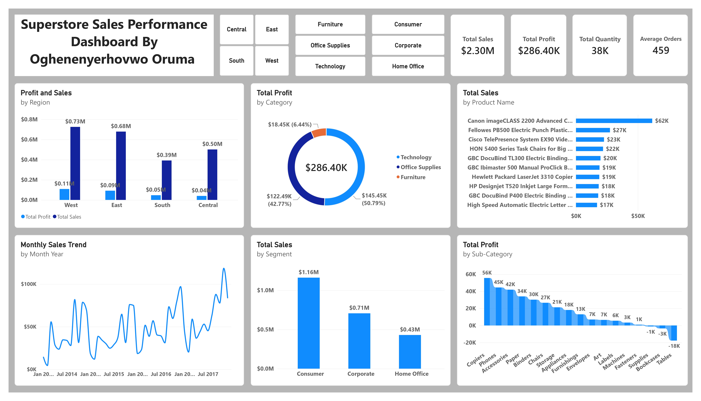

# Sales Performance Analysis – Superstore Dataset

## Project Overview
This project analyzes the sales performance of a retail superstore using **Excel**, **SQL**, and **Power BI**.  
The goal is to identify top-performing regions, categories, products, and customer segments, while also highlighting areas with low or negative profitability.

## Business Questions Answered
- What is the overall sales and profit performance?
- Which region generates the highest sales and profit?
- Which product categories and sub-categories perform best?
- What is the monthly sales trend over time?
- Which products generate the highest sales?
- How do different customer segments perform?

## Dataset
- **Source**: Sample Superstore Dataset (public)
- **Records**: 9,994 rows
- **Period**: 2014 – 2017
- **Tools Used for Cleaning**: Microsoft Excel

## Tools Used
- **Microsoft Excel** → Data cleaning and preparation
- **SQL Server** → Data analysis and insights generation
- **Power BI** → Interactive dashboard and data visualization

## Key Insights
- The **West region** recorded the highest sales and profit.
- **Technology** is the top-performing category by sales.
- **Office Supplies** has the highest profit margin among categories.
- Some high-selling products (particularly certain Tables, Machines, and Bookcases) generated negative profit.
- The **Consumer** segment contributed the highest sales and has the largest number of customers.

## Project Structure
01-sales-performance-analysis/
data/                  → Cleaned Superstore dataset,
sql/                   → SQL analysis queries,
powerbi/               → Power BI dashboard (.pbix file + screenshot), 
README.md

## Dashboard Preview

## How to Explore This Project
1. Review the cleaned data in the `data` folder.
2. Open and run the SQL queries in the `sql` folder.
3. Open the Power BI dashboard in the `powerbi` folder to explore interactive visuals.

---

**Author**: Oghenyerhovwo Oruma  
**GitHub**: [Thissnate](https://github.com/Thissnate)  
