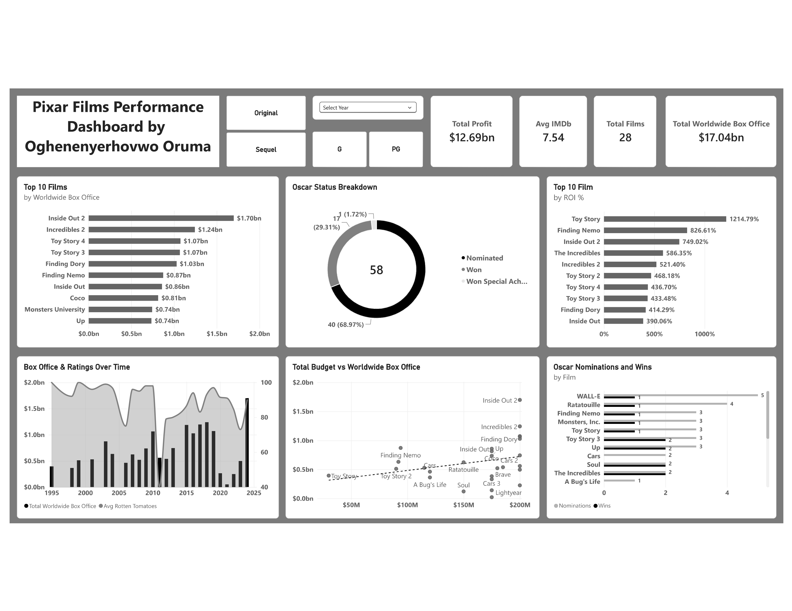

# Pixar Films Performance Analysis

## Project Overview
This project analyzes the performance of Pixar films using **SQL** and **Power BI**.  
It explores box office success, return on investment (ROI), critical ratings, Academy Award results, and trends over time.

## Business Questions Answered
- Which Pixar films performed best at the box office?
- Which films delivered the highest return on investment (ROI)?
- Is there a relationship between budget and box office revenue?
- How successful are Pixar films at the Academy Awards?
- How have box office performance and ratings evolved over time?
- How do Original films compare to Sequels?

## Dataset
- **Source**: Maven Analytics – Pixar Films Dataset
- **Number of Films**: 28
- **Tables Used**: pixar_films, box_office, academy, public_response, pixar_people, genres

## Tools Used
- SQL Server → Data cleaning and analysis
- Power BI → Interactive dashboard

## Key Insights
- **Inside Out 2**, **Incredibles 2**, and **Toy Story 4** are among the highest-grossing films.
- **Toy Story** has the highest ROI due to its relatively low budget.
- Average IMDb rating across all films is **7.54**.
- Pixar films have received a strong number of Oscar nominations, with **WALL-E** leading.
- Sequels generally perform very well at the box office.

## Project Structure
- **data/** → Dataset files
- **sql/** → SQL analysis queries
- **powerbi/** → Power BI dashboard + screenshot
- **README.md**

## Dashboard Preview

## Author
**Oghenyerhovwo Oruma**  
GitHub: [Thissnate](https://github.com/Thissnate)
