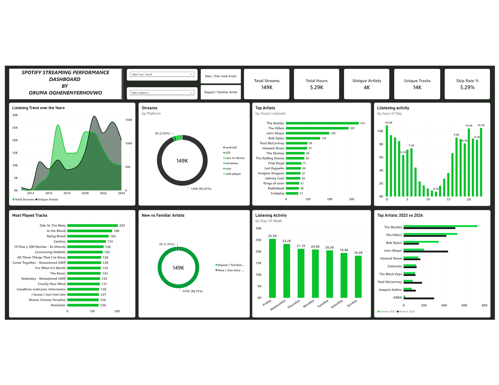

# Spotify Streaming History Analysis

## Project Overview
This project analyzes personal Spotify streaming history using **Excel**, **SQL**, and **Power BI**.  
It explores listening habits, top artists & tracks, skip behaviour, platform usage, and discovery vs loyalty patterns over 11+ years.

## Business Questions Answered
- Which artist was listened to the most this year? Was it the same as last year?
- Which songs were played the most and how often were they skipped?
- What time of day (and day of week) is music typically listened to?
- How often are new artists explored versus replaying familiar favourites?

## Dataset
- **Source**: Maven Analytics – Spotify Streaming History
- **Original rows**: 149,860
- **Cleaned rows**: 148,675
- **Date range**: July 2013 – December 2024
- **Unique artists**: 4,112
- **Unique tracks**: 13,661

**Cleaning steps:**
- Removed 1,185 full duplicate rows
- Filled nulls in `reason_start` and `reason_end`
- Added helper columns (`minutes_played`, `hours_played`, `year`, `month`, `hour`, `day_of_week`)

## Tools Used
- Excel / Power Query → Data cleaning
- SQL Server → Data analysis
- Power BI → Interactive dashboard

## Key Insights
- **The Beatles** are the most listened-to artist (333.1 hours), followed by The Killers and John Mayer.
- Peak listening occurs late night / early morning (**12 AM – 2 AM**).
- **Android** accounts for 93.9% of all streams.
- Strong preference for familiar/repeat artists over new ones.
- John Mayer and ABBA showed notable growth in 2024.

## Project Structure
- **data/** → Data dictionary + cleaned CSV
- **sql/** → SQL analysis queries
- **powerbi/** → Power BI dashboard (.pbix) + screenshot
- **README.md**

## Dashboard Preview

## Author
**Oghenenyerhovwo Oruma**  
GitHub: [Thissnate](https://github.com/Thissnate)
